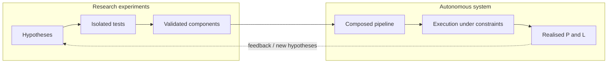
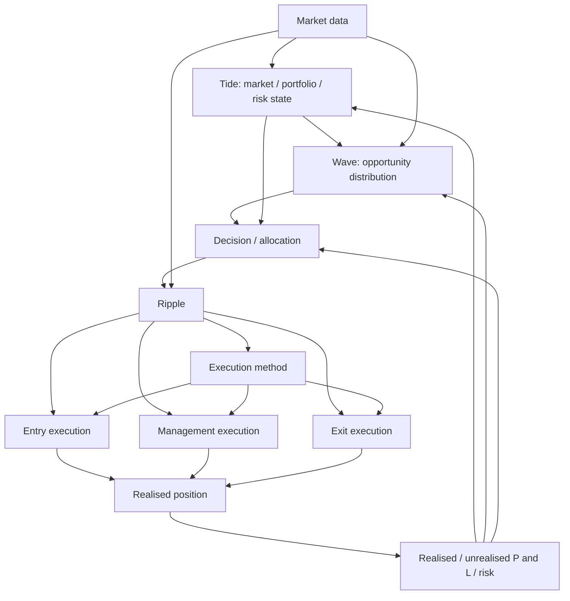
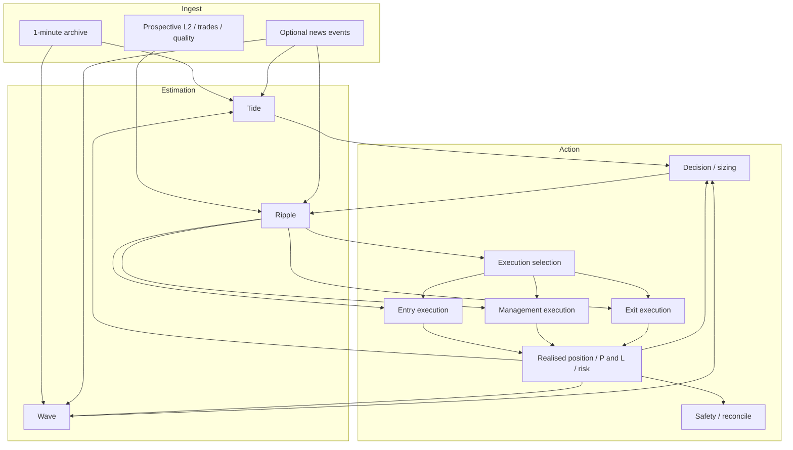
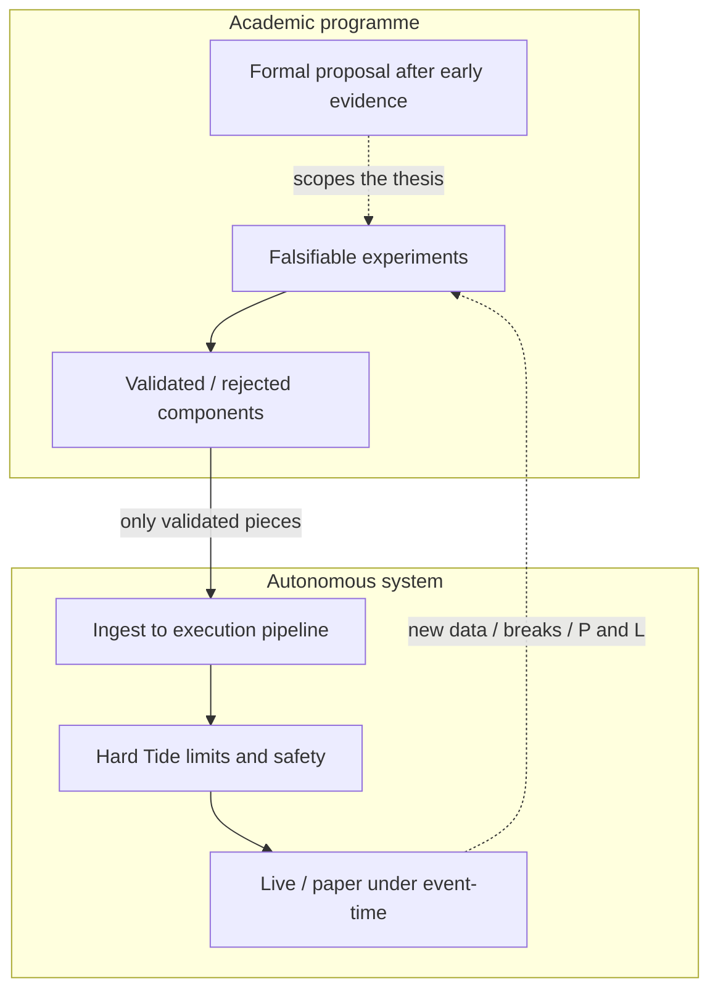

# Tide / Wave / Ripple — Strategy, Research, and Implementation Roadmap

## Status of this document

This file is the **canonical strategy, research, and implementation roadmap** for the Tide / Wave / Ripple programme.

It defines:

- strategy architecture
- research hypotheses
- research sequencing
- experiment methodology
- component dependencies
- notebook and workstream mapping
- implementation progression
- validation gates
- integration gates
- paper-trading promotion criteria

It is the document that answers both **what the strategy is** and **how it will be built and validated**. Research and software progress together (§30). The intended path is:

```text
DATA
  → RESEARCH NOTEBOOK
  → HYPOTHESIS TEST
  → RESEARCH RESULT
  → VALIDATION GATE
  → REUSABLE CODE
  → UNIT / INTEGRATION TESTS
  → BACKTEST / EVENT-TIME REPLAY
  → COMPOSED STRATEGY
  → PAPER TRADING
  → LIVE ELIGIBILITY
```

Live eligibility is a review state. It is not a commitment to place real orders.

| Status | Meaning in this document |
|---|---|
| **Current design** | Architectural commitments that subsequent research, data, implementation, and testing documents must respect. |
| **Candidate hypothesis** | A falsifiable claim. Not a fact. May be rejected. |
| **Validated component** | A claim that has survived its declared experiment protocol **and** the promotion state in §23. None of H1–H19 is validated at the time of writing. |
| **Future extension** | Intentionally deferred. Must not become a hidden assumption of the initial research programme. |
| **Lifecycle state** | Where a hypothesis sits on the path in §23. Economic hypotheses are **Proposed** unless a registered experiment says otherwise. |

The historical design document `strategy.md` records an earlier, implementation-oriented V1 (deterministic Tide bias, Wave permission matrix, Ripple bounce/breakout). It may be used for terminology, feature definitions, and engineering history. **It is not the current strategy specification.** Do not treat its defaults, state machines, or trade archetypes as established truth. Existing notebooks `notebooks/00`–`09` walk through that V1. They are not the hypothesis notebooks in §27, and their outputs are not confirmatory evidence for H1–H19.

This document is **not**:

- a detailed API contract
- a complete production configuration catalogue
- a database schema
- a broker-specific implementation manual
- a claim that the strategy is profitable

Detailed technical contracts may still be maintained separately. If those documents contradict this roadmap, this roadmap wins until it is deliberately revised.

---

## 1. Dual objectives

The programme has two connected objectives.

### 1.1 Academic

Complete a Master's quantitative finance research project with a defensible programme:

- explicit hypotheses and nulls
- declared information sets
- nested benchmarks and ablations
- out-of-sample validation
- statistical *and* economic evaluation
- calibration of probabilistic forecasts and risk measures

A formal research proposal will be finalised **after** initial experimentation shows which hypotheses are worth concentrating on. Early work is exploratory in *topic selection*, not sloppy in *protocol*.

### 1.2 Practical

Develop a genuinely profitable autonomous trading strategy spanning:

data ingestion → market/portfolio state → opportunity modelling → decision/allocation → execution → fills / P&L / risk → feedback.

Profitability is an **empirical objective**, not an assumption. A well-specified system that cannot beat nested benchmarks after costs is a valid research outcome.

### 1.3 Coupling

Research experiments validate *components*. Validated components may be composed into the autonomous system. Composition is itself a hypothesis: independently useful modules need not remain useful together.



---

## 2. Architectural principles

### 2.1 Three layers of information and responsibility

| Layer | Role | Typical horizon |
|---|---|---|
| **Tide** | Market and portfolio *state*: risk, capital, budgets, tails, factors, regime probabilities, hedges | Hours to days (slow state) |
| **Wave** | Conditional *opportunity*: market-state modelling, return/first-passage distributions | Minutes to hours (meso) |
| **Ripple** | Microstructure *and execution of authorised actions*: order flow, liquidity, timing, method, fill/impact | Event scale (fast) |

The hierarchy is **information and responsibility**, not unquestioned causal superiority. Tide does not “know the truth” about Wave; Wave does not render Ripple irrelevant. Lower layers may contain incremental information after conditioning on higher layers. That increment is a research question, not a design axiom.

### 2.2 Prediction ≠ decision ≠ execution

This is the central operating principle.

1. **Models estimate distributions** (or functionals of distributions).
2. The **decision layer** asks whether an action has sufficient expected economic value subject to risk, capacity, and execution constraints.
3. **Ripple** determines how an *authorised* entry, management action, or exit
   should be executed given current microstructure. It may supply evidence and
   feasible actions to the decision layer, but it does not authorise exposure.

A high probability of a favourable first passage is not a trade. A trade is not a fill. A fill is not a realised economic outcome after risk.

Nor does the decision process end at an entry fill. Once exposure exists, new
Tide, Wave, and Ripple information may justify holding, reducing, scaling,
repricing, hedging, exiting, or emergency-exiting. A reversal is a new exposure
and requires independent authorisation by the decision framework; it is not an
implicit consequence of closing the prior position.

Wave must **not** be reduced to `{LONG, SHORT, NEUTRAL}`. Those labels may appear as *derived summaries* of a distribution; they are not the Wave object.

### 2.3 Complexity is not progress

Each modelling extension is a hypothesis to be tested against a simpler nested model. Additional complexity is justified only by incremental statistical or economic value after costs, leakage controls, and multiple-testing discipline.

### 2.4 Deterministic baselines remain useful

Rule-based Tide/Wave/Ripple artefacts from the historical V1 are **baselines and candidate policies**, not the destination. They exist to be beaten, matched, or retained if they survive comparison.

---

## 3. System overview

### 3.1 Fundamental flow



News/event state, if used, enters as structured information into Tide/Wave/Ripple — never as a direct order (see §12).

The complete authorised lifecycle, which may iterate while a position is open, is:

1. opportunity identification (Wave);
2. exposure authorisation (Decision, subject to Tide);
3. entry execution (Ripple);
4. open-position state;
5. position-management decision (Decision, informed by Tide/Wave/Ripple);
6. exit decision, when one is authorised (Decision);
7. execution of the authorised action (Ripple);
8. realised outcome (fills, P&L, inventory);
9. portfolio-risk re-evaluation (Tide) and return to (1)–(5).

An open position is a **closed-loop control problem**: the system repeatedly
observes state, updates beliefs, evaluates constraints, and chooses among
authorised actions. This is the conceptual structure for subsequent research,
not a deterministic trading rule.

$$
\text{opportunity}
\rightarrow \text{exposure authorisation}
\rightarrow \text{entry execution}
\rightarrow \text{open position}
\rightarrow \text{management / exit decision}
\rightarrow \text{execution of authorised action}
\rightarrow \text{realised P\&L / risk}
\rightarrow \text{Tide/Wave/Ripple update}
\rightarrow \text{Decision re-authorisation}.
$$

Position management is a research problem, not a bag of arbitrary rules.
Actions such as hold, scale, reduce, reprice, hedge, or exit require the same
discipline of conditional evidence, costs, risk constraints, and nested
comparison as the original entry.

### 3.2 Layer questions

| Layer | Question it answers |
|---|---|
| Tide | What is the current market and *portfolio* situation, and how much risk may be taken? |
| Wave | Conditional on $\mathcal{F}_t$, what is the distribution of future returns / first-passage outcomes? |
| Decision | Does any feasible action $a$ have sufficient expected utility after costs, subject to Tide constraints? |
| Ripple | Given an authorised entry, management action, or exit, what is the microstructure state and how should that action be executed? |

Ripple is the only layer that **submits** orders. Tide and Wave do not trade.

### 3.3 Operational and information architectures

The **operational architecture** is ordered:

$$
\text{Tide} \rightarrow \text{Wave} \rightarrow \text{Decision}
\rightarrow \text{Ripple} \rightarrow \text{Execution}.
$$

It identifies authority: models describe, the decision layer authorises every
change in exposure, and Ripple translates each authorised action into order
timing and method while maintaining operational position integrity.

The **information architecture** is not purely downstream. Tide, Wave, and
Ripple may each contain information with incremental predictive value. For
example, order flow may refine first-passage probabilities even though Ripple
cannot independently authorise portfolio risk. Such incremental value must be
tested by nested conditioning and ablation; operational authority must not be
confused with predictive content.

### 3.4 Three clocks

The programme distinguishes three conceptual clocks. They need not coincide.

| Clock | Question | Typical grain |
|---|---|---|
| **Forecast clock** | Over what horizon $h$ does Wave predict outcomes? | Meso: the Wave object’s $h$ |
| **Position-management clock** | How often does Decision reassess an existing position? | Slower than event time; not necessarily equal to $h$ |
| **Execution clock** | When may Ripple reassess fills, quotes, and cancellations? | Event-time order-book and trade updates |

Wave may estimate a multi-minute opportunity while Ripple reacts to individual
book events. The event-time backtester must not collapse these clocks into a
single bar. Numerical frequencies are experimental, not architecture.

### 3.5 Strategy control hierarchy

Authority is hierarchical. Information is not.

```text
HARD SAFETY CONSTRAINTS
        ↓
TIDE PORTFOLIO RISK CONSTRAINTS
        ↓
DECISION / EXPOSURE AUTHORISATION
        ↓
WAVE OPPORTUNITY MODEL          ← informational, not an authority layer
        ↓
POSITION-MANAGEMENT DECISION    ← still Decision, with position state
        ↓
RIPPLE EXECUTION / MICROSTRUCTURE
        ↓
ORDER / FILL
        ↓
REALISED POSITION
        ↓
FEEDBACK → Tide, Wave, Decision
```

Hard safety and Tide constraints can forbid exposure even when Wave is
favourable. Wave and Ripple may still supply incremental *information* to
Decision. Ripple never creates unapproved risk.

---

## 4. Mathematical foundation

### 4.1 Price convention

Work in log price:

$$
X_t = \ln P_t
$$

Log returns over horizon $h$:

$$
R_{t:t+h} = X_{t+h} - X_t
$$

### 4.2 Initial stochastic model

The starting continuous-time description is a diffusion

$$
dX_t = \mu_t\, dt + \sigma_t\, dW_t
$$

with drift and diffusion that may later be conditioned on slow state $Z_t$ (Tide/Wave) and microstructure $O_t$ (Ripple).

This is a **working model**, not a claim that prices are Gaussian, continuous, or Markov.

### 4.3 Fokker–Planck equation

If $p(x,t)$ is the density of $X_t$, the Fokker–Planck (forward Kolmogorov) equation associated with the diffusion is

$$
\frac{\partial p}{\partial t}
= -\frac{\partial}{\partial x}(\mu p)
+ \frac{1}{2}\frac{\partial^2}{\partial x^2}(\sigma^2 p)
$$

Probability flux (useful for first-passage and barrier problems):

$$
J(x,t) = \mu p - \frac{1}{2}\frac{\partial}{\partial x}(\sigma^2 p)
$$

Flux is a **research object**: it may clarify how probability mass moves toward a target or stop. It is not required for the initial experiments.

### 4.4 Wave objects

Wave may estimate one or both of:

$$
p(R_{t:t+h} \mid \mathcal{F}_t)
$$

$$
\mathbb{P}(\tau_{\text{target}} < \tau_{\text{stop}} \mid \mathcal{F}_t)
$$

For target barrier $B_T$ and stop barrier $B_S$, the long-side convention is:

$$
\tau_T = \inf\{u>t:X_u\ge B_T\},
\qquad
\tau_S = \inf\{u>t:X_u\le B_S\}.
$$

For a short exposure the inequalities reverse: the target is reached below
the entry region and the stop above it. More generally, “target” and “stop”
are trade-relative labels on an ordered barrier pair, not assumptions that the
strategy is long.

The unrestricted target-before-stop object is

$$
\mathbb{P}(\tau_T<\tau_S\mid\mathcal{F}_t),
$$

while a finite usable execution horizon $H$ gives

$$
\mathbb{P}(\tau_T<\tau_S,\;\tau_T-t\le H\mid\mathcal{F}_t).
$$

Barrier definition, horizon, target/stop distance, and whether barriers are
state-dependent are experimental choices. The programme must distinguish:

- terminal return probability, such as $\mathbb{P}(X_{t+H}>X_t)$;
- first-passage probability;
- the distribution of first-passage time;
- target-before-stop probability; and
- the probability that an actionable opportunity occurs within the usable
  execution horizon.

None of these is automatically an **executable** opportunity after costs,
liquidity, risk, and latency (§6.3).

Terminal probability is not equivalent to first-passage probability: the path
may cross one or both barriers before ending elsewhere.

Expected-return and risk functionals are derived from these objects, not substitutes for them.

### 4.5 Ripple conditioning

A candidate microstructure-conditioned diffusion is

$$
\mu_t = f_\theta(Z_t, O_t), \qquad
\sigma_t = g_\theta(Z_t, O_t)
$$

where $Z_t$ is slow/meso state (Tide/Wave) and $O_t$ is order-book / order-flow information.

The formal conditioning question is whether $O_t$ changes
$p(R\mid\mathcal{F}_t)$, first-passage objects, post-entry decision quality, or
execution-quality distributions after Tide/Wave information is already known.
Section 7.5 decomposes this into testable Ripple targets.

### 4.6 Model progression (hypotheses, not a ladder of truth)

1. Gaussian baseline  
2. Student-$t$ return model  
3. Regime-conditioned Student-$t$  
4. Conditional diffusion ($\mu_t,\sigma_t$ functions of $\mathcal{F}_t$)  
5. Microstructure-conditioned diffusion  
6. Jump-diffusion / Lévy extensions **if justified by evidence**

Do not assume that every extension improves decisions. Nested comparison is mandatory.

### 4.7 Schrödinger representation

A Schrödinger-equation rewriting of the diffusion is an **experimental analogy only**. It is not a foundational assumption of the strategy, not a claim about quantum markets, and not a prerequisite for any other workstream.

---

## 5. Tide — market and portfolio state

### 5.1 Current design

Tide owns **portfolio-level state and constraints**. It does not originate trades.

Responsibilities:

- market and portfolio state
- risk estimation
- capital allocation
- risk budgeting
- tail-risk estimation
- factor exposure
- regime probabilities (as *inputs* to risk, not as trade signals)
- hedge requirements (including later FX; see §13)

Tide should evolve from simple deterministic controls toward **probabilistic portfolio risk**. Hard LONG/SHORT “macro bias” as a primary Tide output is a historical V1 device, not the current target.

### 5.2 Risk-model progression

Again nested hypotheses:

Gaussian risk → Student-$t$ → regime-conditioned Student-$t$ → Monte Carlo / conditional simulation → jump models if evidence requires them.

Candidate metrics (none is mandatory until evaluated):

- volatility
- VaR
- Expected Shortfall (ES)
- stress ES
- factor exposure
- Euler risk contribution
- RORAC (evaluated at opportunity/allocation time; not a Tide “signal”)
- drawdown
- margin / liquidation risk

VaR and ES of a loss $L$ at level $\alpha$:

$$
\mathrm{VaR}_\alpha = \inf\{x:\mathbb{P}(L>x)\le 1-\alpha\}
$$

$$
\mathrm{ES}_\alpha = \mathbb{E}[L \mid L > \mathrm{VaR}_\alpha]
$$

ES is preferred as a *constraint* object because it is coherent (subadditive) under standard conditions; VaR remains useful for diagnostics and regulatory-style backtests.

### 5.3 Risk budget

Decisions are constrained by a live budget $B_t$:

$$
\mathrm{ES}_\alpha(R_p) \le B_t
$$

Euler contributions for a homogeneous risk measure $\rho$:

$$
\rho(\mathbf{w}) = \sum_i w_i \frac{\partial \rho}{\partial w_i}, \qquad
\mathrm{RC}_i = w_i \frac{\partial \rho}{\partial w_i}
$$

Hierarchical budgeting (strategy sleeve × asset × cell) remains a **candidate design** from the historical programme: it is conceptually sound diversification accounting, not yet a validated allocation policy.

### 5.4 Allocation as a research design decision

The eventual problem may be written

$$
\max_a \mathbb{E}[U(R_p \mid a)]
\quad\text{s.t.}\quad
\mathrm{ES}_\alpha(R_p \mid a) \le B_t
$$

plus margin, liquidity, maximum exposure, and execution-feasibility constraints.

**Do not hard-code $U$.** Utility, including mean–ES, growth-optimal, or constraint-only (feasibility) formulations, is a research design decision. RORAC-like ratios may appear as *evaluation* or as *one candidate* objective, not as Tide’s native output.

### 5.5 Uncertainty in risk

Tide estimates must distinguish (see §11):

1. market uncertainty (the random $R_p$)
2. parameter uncertainty
3. model uncertainty

Point ES with no interval or stress overlay implies false precision.

### 5.6 Continuous portfolio-risk re-evaluation

Tide is not merely an entry gate. While a position is open it continually
reassesses candidate measures including portfolio ES, volatility, factor
exposure, regime probabilities, correlation, margin, liquidation risk,
liquidity, and hedge requirement.

The feedback loop is

$$
\text{position}
\rightarrow \text{realised / unrealised risk}
\rightarrow \text{Tide update}
\rightarrow \text{revised risk budget}
\rightarrow \text{position-management decision}.
$$

A deterioration in portfolio risk may force reduction, hedging, exit, or a
prohibition on additional exposure. These are portfolio constraints on the
decision layer, not entry alpha and not discretionary Ripple overrides.

---

## 6. Wave — conditional opportunity

### 6.1 Current design

Wave models **conditional market state and the opportunity distribution**. It does not trade.

It should ultimately publish probabilistic objects, for example:

- $p(R_{t:t+h}\mid\mathcal{F}_t)$ or a parametric family
- $\mathbb{P}(\tau_{\text{target}}<\tau_{\text{stop}}\mid\mathcal{F}_t)$
- $\mathbb{P}(\tau_{\text{target}}<\tau_{\text{stop}},
  \tau_{\text{target}}-t\le H\mid\mathcal{F}_t)$
- $\mathbb{E}[R_{t:t+h}\mid\mathcal{F}_t]$, $\mathrm{ES}_\alpha(R_{t:t+h}\mid\mathcal{F}_t)$
- regime probability vector $\pi_t$
- factor / residual state

Hard regime labels (`MEAN_REVERSION`, `BREAKOUT`, …) may exist as *argmax summaries* of $\pi_t$. Relying solely on a hard label is a degraded interface.

HMM (or similar latent-state) output:

$$
\pi_t = \bigl[\mathbb{P}(S_1\mid\mathcal{F}_t),\ldots,\mathbb{P}(S_K\mid\mathcal{F}_t)\bigr]
$$

State count $K$, emission family, and whether states are economically named are experimental.

Regime probabilities $\pi_t$ are not entry-only information. They may inform
expected opportunity, expected holding time, barrier probabilities, portfolio
risk, execution conditions, and management policy. They must **not** be
hard-mapped as `REGIME X → EXIT`. Regime state is an input to probabilistic
decision-making.

### 6.2 Candidate information

Potential $\mathcal{F}_t$ contents (include only with evidence of incremental information):

- OHLCV and returns
- realised volatility and volatility clustering
- market-structure / session features
- trend efficiency
- VWAP and other statistical anchors
- classical technicals (Bollinger / RSI / MACD) **only if they add information beyond simpler features**
- cross-asset returns
- PCA / factor exposures and residuals
- HMM regime probabilities
- macro variables
- structured news/event state (§12)

Avoid indicator accumulation. Each feature class is an ablation candidate.

Useful structural quantities from the historical programme, retained as *candidates*:

- trend efficiency $\eta = |\sum \Delta P_i| / \sum |\Delta P_i|$
- factor residual dislocation $\delta_{i,t} = r_{i,t} - \hat\beta_i r_{M,t}$
- cross-sectional dispersion $D_t$
- absorption ratio of the correlation spectrum

### 6.3 Executable opportunity

A favourable first-passage object is not automatically a tradable opportunity.
The programme ultimately cares about something closer to

$$
\mathbb{P}(\text{profitable executable opportunity}\mid\mathcal{F}_t)
$$

rather than only $\mathbb{P}(\tau_T<\tau_S\mid\mathcal{F}_t)$.

Spread, commission, slippage, impact, fill probability, latency, liquidity,
margin, portfolio ES, and the remaining opportunity horizon can eliminate
economic value. This is a conceptual bridge among Wave, Tide, Decision, and
Ripple—not a new model and not a prescribed formula.

### 6.4 Wave research question

Does conditional probabilistic modelling improve **decision quality** — not merely in-sample likelihood — relative to unconditional or simple rule-based Wave?

Decision quality is measured after Tide constraints and a declared cost model, on untouched test data.

---

## 7. Ripple — microstructure and execution of authorised actions

### 7.1 Current design

Ripple models **how the market is trading right now** and **how an authorised
entry, position-management action, or exit should be executed**. It may
inform Decision with incremental microstructure information. It cannot
independently authorise portfolio exposure. Its conceptual scope is:

- market microstructure state;
- execution of authorised entry, management, and exit actions;
- execution-method selection; and
- candidate liquidity-state information for Decision.

Candidate information and mechanisms include:

- bid/ask depth and spread
- order-book imbalance, microprice
- OFI, CVD, aggressive trade flow
- wall persistence, cancellation, replenishment, absorption, and exhaustion
- liquidity withdrawal and refill
- volume profile, liquidity voids
- expected slippage, fill probability, adverse selection, latency, and market impact
- passive versus aggressive execution; limit versus market orders
- order cancellation and repricing; partial fills; scaling in and out
- first-passage *refinement* given $O_t$

This is a candidate information set, not a required feature list. Each item
must justify itself by incremental value relative to a nested simpler model.

Ripple is not merely “the layer that fires bounce and breakout.” Those archetypes are **historical baselines and candidate policies**.

### 7.2 Candidate observables

Notation retained from the historical programme where still useful:

$$
I_t = \frac{V^b_t - V^a_t}{V^b_t + V^a_t}
$$

$$
P_\mu = P^a_t \frac{V^b_t}{V^b_t+V^a_t} + P^b_t \frac{V^a_t}{V^b_t+V^a_t}
$$

OFI, CVD, impact per unit aggressive volume, and wall-quality scores are **candidate features**. Their incremental value after Wave/Tide conditioning is the scientific question.

Liquidity-state labels (stable, absorption, exhaustion, withdrawal, refill) are a **candidate latent taxonomy**, not a required ontology.

### 7.3 Dynamic wall and liquidity interaction

A liquidity wall is not defined solely by displayed depth exceeding a static
threshold. A candidate dynamic wall-strength object is

$$
W_t=f(
\text{displayed depth},
\text{aggressive flow},
\text{cancellation},
\text{replenishment},
\text{trade intensity},
\text{distance from price},
\text{absorption behaviour},
\text{time persistence}
).
$$

The functional form, memory, normalisation, and whether a scalar score is even
adequate are research questions. Distinguish at least these candidate
outcomes:

1. **penetration** — aggressive trading consumes displayed liquidity;
2. **rejection** — price approaches and is turned away while liquidity remains;
3. **absorption** — flow is taken without a durable barrier breach;
4. **replenishment** — consumed or cancelled size is replaced;
5. **withdrawal / disappearance** — displayed liquidity leaves before being
   consumed.

$$
\text{wall failure} \neq \text{wall disappearance}.
$$

A wall may fail because aggressive trading consumes it, or because displayed
liquidity withdraws. Those are different microstructure states. Cancellation
behaviour must not be labelled spoofing without evidence of intent.

### 7.4 Dynamic walls as candidate first-passage barriers

For a candidate wall at $x_w$, define

$$
\tau_w=\inf\{u>t:X_u\text{ reaches }x_w\}.
$$

Conditional on order-book state $O_t$, candidate objects include:

$$
\mathbb{P}(\text{penetration}\mid O_t),\quad
\mathbb{P}(\text{rejection}\mid O_t),\quad
\mathbb{P}(\text{withdrawal}\mid O_t),
$$

and, where identification permits,

$$
\mathbb{E}[\tau_{\text{event}}\mid O_t].
$$

These are candidate conditional outcomes, not assumptions. The research
question is whether dynamic liquidity state improves prediction of barrier
outcomes after conditioning on Wave/Tide information. A limit-order-book wall
is not a physical Fokker–Planck boundary; flux toward $x_w$ is one
representation among others.

### 7.5 Central Ripple research question

Does microstructure information provide incremental information about:

1. short-horizon price movement,
2. first-passage / target-vs-stop probability,
3. post-entry position-management decisions, and
4. execution quality (fill, slippage, impact)

after conditioning on Wave and Tide information?

A feature that predicts mid-price ticks but does not improve post-cost allocation or execution may still be scientifically interesting; it is not automatically a trading edge.

### 7.6 Execution method as a separate problem

Even a correctly signed Wave distribution can be destroyed by costs. Model execution cost as a research object:

$$
C_{\text{execution}}
= \text{spread}
+ \text{commission}
+ \text{slippage}
+ \text{market impact}
+ \text{funding}
+ \text{latency effects}
$$

The final strategy is evaluated **after** a realistic $C_{\text{execution}}$. Optimistic fills are not results.

Candidate execution actions include

$$
a_t^{\mathrm{exec}}
\in
\{
\text{MARKET},\;
\text{AGGRESSIVE LIMIT},\;
\text{PASSIVE LIMIT},\;
\text{WAIT},\;
\text{CANCEL},\;
\text{REPRICE},\;
\text{SCALE}
\}.
$$

These are candidate actions, not fixed rules. The conceptual execution-value
problem is of the form

$$
V(a_t^{\mathrm{exec}})
=
\mathbb{E}[\text{fill value}]
-
\mathbb{E}[\text{adverse selection}]
-
\mathbb{E}[\text{market impact}]
-
\mathbb{E}[\text{opportunity cost}]
-
\mathbb{E}[\text{inventory cost}],
$$

subject to parent exposure authorisation, risk limits, liquidity constraints,
latency, and partial-fill uncertainty.

Ripple’s research question is not merely “market versus limit.” It is: given
an authorised exposure change, which feasible execution action has the best
expected economic outcome conditional on current microstructure?

**WAIT** is a genuine economic action, not a miscellaneous fallback.
Conceptually,

$$
V_{\mathrm{wait}}
=
\mathbb{E}[V_{t+\Delta t}]
-
C_{\mathrm{opportunity}}
-
C_{\mathrm{adverse movement}}.
$$

This is a research formulation, not a claimed optimum. Waiting has economic
value only if expected improvement from future information or liquidity
exceeds opportunity cost and the risk of adverse movement. Delay is not a
rule-based timeout.

Full autonomous market making or continuous two-sided quoting remains a
distinct deferred strategy (§20); conditional market-maker-style execution is
in scope because it affects entry, management, and exit economics.

### 7.7 Inventory and asymmetric execution outcomes

Any passive or scaling policy must model, or conservatively bound:

- inventory risk and unwanted accumulation;
- partial fills and queue position;
- fill uncertainty and cancellation probability;
- adverse selection and price moving away after a passive fill;
- liquidity disappearing before completion; and
- asymmetric execution outcomes across entry and exit.

These considerations are necessary to test conditional liquidity provision;
they do not establish a full market-making thesis.

---

## 8. Decision layer and position sizing

### 8.1 Current design

The decision layer sits between Wave’s distribution and Ripple’s expression.

It maps

$$
\bigl(p(\cdot\mid\mathcal{F}_t),\; \text{Tide state},\; \text{position state},\;
\widehat{C}_{\text{execution}},\; \text{constraints}\bigr)
\;\to\;
a_t
$$

where $a_t$ may be “do nothing.” Doing nothing is a first-class action. Before
entry, $a_t$ may authorise or reject exposure; after entry, it may authorise
hold, reduce, scale in/out, reprice, hedge, exit, or emergency exit. Execution
method remains Ripple’s responsibility within that authorisation.

### 8.2 Conceptual trade state

Open-position control requires a conceptual **trade state**: the information
needed to manage an existing exposure. This is not a production schema. It
exists so the system can answer:

> Given what I currently hold, what do I currently believe, what risk remains,
> what opportunity remains, and what would it cost to change the position?

Conceptually it includes ideas such as:

- current position quantity and direction;
- entry price, current mark, and entry timestamp;
- elapsed holding time;
- remaining risk budget;
- current target/stop or barrier state;
- current Wave opportunity distribution;
- current target-before-stop and finite-horizon opportunity probabilities;
- current Tide portfolio-risk state;
- current Ripple microstructure state;
- estimated execution cost;
- liquidity / capacity state;
- current working orders;
- realised and unrealised P&L.

Exact production fields are an implementation concern.

### 8.3 The NO-TRADE region

Forecasting a movement is not sufficient to trade. A conceptual economic
hurdle of the form

$$
\mathbb{E}[V_{\mathrm{trade}}]
\le
C_{\mathrm{execution}} + C_{\mathrm{risk}}
$$

may imply

$$
a_t = \text{NO TRADE}.
$$

This is not a numerical threshold. The system does not need to predict every
market movement. It needs to identify situations where expected economic
value is sufficient relative to risk and implementation cost. That is the
distinction between forecasting and decision-making.

### 8.4 Position sizing is a decision problem

Sizing is not a fixed formula (fixed fractional, raw signal strength, historical V1 ES throttle) unless that formula wins a nested comparison.

Candidate inputs:

- expected return / expected utility
- $\mathbb{P}(\tau_{\text{target}}<\tau_{\text{stop}}\mid\mathcal{F}_t)$
- the probability that target-first opportunity occurs within usable horizon $H$
- ES of the candidate position
- liquidity and estimated execution cost
- regime probabilities $\pi_t$
- model confidence / calibration
- margin
- hedge cost

RORAC-like quantities belong **here** (opportunity vs risk capital), not as a Tide broadcast that Ripple blindly follows.

### 8.5 Permissions vs probabilities

The historical Wave “permission matrix” (enable/disable bounce vs breakout) is a crude decision policy. A probabilistic Wave plus an explicit utility/constraint problem is the intended replacement. Permissions may remain as hard safety interlocks (e.g. flatten-only under Tide crisis), which is an operational constraint, not a market model.

### 8.6 Exit and position management

The trading decision does not end when an entry order fills. Exit and
position-management policies are separate research objects with nested
baselines. Management actions should be associated with **reasons for
change**, not a single generic post-entry signal.

**Opportunity deterioration.** The Wave distribution or first-passage
opportunity becomes less favourable. Possible responses: hold, reduce, exit.

**Portfolio-risk deterioration.** Tide risk or portfolio constraints
deteriorate. Possible responses: reduce, hedge, prohibit scaling, exit, or
emergency exit if a hard safety constraint is breached.

**Microstructure deterioration.** Ripple detects worsening execution or
liquidity. Possible responses: wait, reprice, change execution method, reduce,
or exit if the execution environment materially changes expected economics.

**Opportunity improvement.** The conditional opportunity improves after entry.
Possible responses may include hold, scale, adjust target, or continue
exposure. Improvement does **not** automatically justify scaling.

**Opposite opportunity.** A new opposing opportunity appears. Closing the
existing exposure and opening the opposite exposure are **separate
decisions**. A reversal must not be an implicit consequence of an exit.

**Static exit.** Fixed targets and stops are transparent baselines, not assumed
optima. Time-based and trailing-stop exits are additional simple comparators.

**Distribution-aware exit.** Wave may re-estimate

$$
\mathbb{P}(\tau_T<\tau_S\mid\mathcal{F}_t)
$$

and its finite-horizon counterpart throughout the life of the position. The
distribution at entry need not remain the distribution later. Regime
probabilities $\pi_t$ may inform these objects without implying a
regime-to-exit rule.

The programme tests whether sequential, live-compatible re-evaluation while
exposure is open improves on executing the entry plan unchanged until a
static barrier.

### 8.7 Conceptual position state machine

The operational lifecycle is:

```text
FLAT → ENTRY_PENDING → OPEN → EXIT_PENDING → FLAT
```

While `OPEN`, authorised management actions may include:

```text
HOLD | SCALE_IN | SCALE_OUT | REPRICE | RISK_REDUCTION |
HEDGE | EXIT | EMERGENCY_EXIT
```

This linear representation is a conceptual control-flow simplification, not a
claim that operational quantities are mutually exclusive. Partial fills may
leave entry, open-position, and exit quantities coexisting; actual reconciled
broker inventory and working orders are authoritative, not the state label or
intent. Reversal requires closing or otherwise accounting for the existing
position and obtaining a separately authorised new exposure.

The state machine is an engineering and execution-integrity mechanism, not the
trading strategy. Models and the decision layer determine *why* a transition
is appropriate; the state machine makes the authorised transition
deterministic, reconcilable, and fail-closed.

### 8.8 Entry, management, and exit are different research problems

Information useful for entry need not be useful for management or exit. At
entry, Wave may identify a favourable opportunity distribution and Ripple may
confirm feasible liquidity. After entry, Wave’s distribution, Ripple’s
microstructure, and Tide’s portfolio risk may all change.

Entry quality, trade-management quality, and exit quality must therefore be
tested separately.

Continuously reassessing a position creates a risk of **post-entry selection
bias**. Repeatedly observing the path and selecting the best-looking exit
retrospectively would contaminate the result with hindsight. Live-compatible
policies must use only information available at each decision time,
$\mathcal{F}_t$. Post-entry decisions must be evaluated sequentially, not by
using the future path to choose an optimal exit after the fact. Estimators
remain a later methodological choice; the principle is information-set
integrity.

---

## 9. Data

### 9.1 Current design

**1-minute research dataset.** Approximately five years of 1-minute price data are available now. This is the starting information set for Wave/Tide statistical work (H1–H6 and the non-L2 branches of later hypotheses) and for simple execution-cost *proxies*. The 1-minute programme does not wait for L2.

**Prospective L2 / order-flow collection is an active parallel workstream.** The collector is operational and accumulating raw events. That does **not** mean the L2 sample is already sufficient for validation. Historical L2 remains scarce. Confirmatory tests that require true books, queue position, or own-order outcomes (H7, H9, H16–H18, and the microstructure branches of H8, H14, and H19) may use only the prospective archive that exists at test time, with its quality record. They cannot be backdated through unavailable history. Do not invent synthetic books and then treat them as historical truth. Do not report a 1-minute proxy and an L2 result as one sample.

**Raw events are retained** so derived datasets (books, CVD, OFI, bars) can be regenerated. Derived products are not the source of truth.

### 9.2 What must be preserved

- exchange timestamp
- local receipt timestamp
- sequence / update IDs where available
- raw depth updates
- snapshots
- trades
- instrument identity
- session / connection metadata
- data-quality information

Two clocks matter: **exchange event time** and **local receipt time**. Latency, staleness, and look-ahead errors are undefined if only one exists.

### 9.3 Data quality is a research concern

Detect and count, at minimum:

- missing events
- sequence gaps
- duplicates
- out-of-order events
- stale books
- reconnects
- timestamp anomalies

Quality filters change the sample. Every skip/quarantine must be counted. “Clean data” without a quality paper is a specification of a different process than live trading.

Survivorship, listing/delisting, and contract specification changes (tick size, fees, funding) are part of the data generating process.

---

## 10. Research methodology

### 10.1 Experiment contract

Every experiment defines:

| Field | Content |
|---|---|
| Hypothesis | What is claimed |
| Null | What would count as no effect |
| Dataset | Universe, venue, frequency, quality filters |
| Information set $\mathcal{F}_t$ | Features allowed at decision time |
| Training period | Fit / estimate |
| Validation period | Model selection, early stopping, calibration |
| Untouched test period | Final evaluation only |
| Benchmark | Nested simpler alternative |
| Model | Family and estimation method |
| Parameters | Free vs frozen |
| Evaluation metrics | Statistical |
| Statistical tests | Including multiple-testing handling |
| Economic metrics | After declared costs, risk, capacity |
| Result | What was observed |
| Decision | Adopt / reject / revise / defer |

Exploratory analysis that violates this contract may generate hypotheses. It may not be reported as a confirmatory result.

### 10.2 Explicit controls

The programme must control for:

- look-ahead bias
- survivorship bias
- data leakage (including label leakage and same-bar features)
- multiple testing
- parameter overfitting
- model-selection bias
- non-stationarity
- transaction costs, slippage, market impact
- latency
- capacity

Event timestamps for news must be the **earliest available** timestamp, not publication scrape time if that is later (see §12).

### 10.3 Calibration

Probabilistic predictions are evaluated for **calibration**, not only directional accuracy.

Relevant diagnostics:

- log-likelihood
- Brier score (for unrestricted and finite-horizon target-before-stop events)
- reliability diagrams
- probability calibration
- distributional calibration (PIT, interval coverage)
- VaR exceedance tests
- ES backtesting

A sharp but miscalibrated model is not a risk model.

### 10.4 Benchmark hierarchy

Compare increasing complexity. A suggested forecasting / allocation ladder
(items may be added or skipped; none is sacred):

1. Random / unconditional baseline  
2. Buy-and-hold  
3. Simple momentum  
4. Simple mean reversion  
5. Volatility targeting  
6. Simple regime strategy  
7. Simple ML model  
8. Hierarchical (Tide/Wave) model without microstructure  
9. Full Tide / Wave / Ripple system after costs  

Trade-management baselines include:

- entry-only management (execute the initial plan without information updates);
- fixed target/stop;
- trailing stop;
- time-based exit;
- distribution-aware exit; and
- microstructure-aware exit.

Execution baselines include:

- market-on-signal;
- fixed passive limit;
- fixed aggressive limit; and
- dynamic execution selection.

Liquidity-interaction baselines include:

- no-wall model;
- static wall threshold; and
- dynamic wall model.

When evaluating exit, management, or execution, use the same parent trade
decisions wherever the estimand permits.

### 10.5 Ablation

Support staged information sets, for example:

```
market data only
  → + technical / structural features
  → + HMM
  → + PCA / factors
  → + Tide risk state
  → + news/event state
  → + order flow
  → + dynamic trade management
  → + execution selection
```

Do not assume every layer adds value. Negative ablations are first-class results.

### 10.6 Statistical vs economic significance

A significant likelihood-ratio improvement that does not survive costs, capacity, or ES constraints does not promote a component into the autonomous system. Conversely, a noisy economic edge without a coherent statistical story is treated as provisional, not validated.

### 10.7 Separate sources of economic value

The research programme contains at least three distinct potential sources of
economic value:

1. **Forecast / alpha value:** does Wave predict future opportunity?
2. **Trade-management value:** conditional on the same entry, does dynamic
   management improve the realised trade distribution?
3. **Execution value:** conditional on the same approved exposure and
   management decision, can Ripple improve fills, costs, and impact?

These must be tested separately before composition. Realised trade P&L cannot
automatically be attributed to one layer merely by looking at live outcomes.
A conceptual decomposition such as

$$
\mathrm{P\&L}_{\mathrm{trade}}
\approx
\mathrm{P\&L}_{\mathrm{forecast}}
+
\mathrm{P\&L}_{\mathrm{management}}
+
\mathrm{P\&L}_{\mathrm{execution}}
-
C
$$

is an **experimental attribution framework**, not a uniquely identifiable
accounting identity. Attribution uses nested counterfactuals (§10.8). Isolated
gains may interact or disappear, so the composed system still requires an
end-to-end test.

### 10.8 Counterfactual principle

When estimating the incremental value of a downstream component, **hold
upstream decisions fixed wherever possible**. This is an experimental
control, not necessarily how the final autonomous system operates. The fully
composed system must still undergo an independent end-to-end test.

Examples:

- H14: same entries, different exit policy.
- H15: same entries, risk-authorisation policy changed.
- H16: same parent decisions, wall information added.
- H17: same authorised exposure, execution policy changed.
- H19: same entries and parent dynamic-exit policy, scaling/partial-exit
  policy changed.

A schematic nested experiment:

```text
Same parent entry
       │
       ├── Static TP/SL
       ├── Dynamic binary exit
       └── Dynamic management
                 │
                 ├── Fixed execution
                 └── Dynamic execution
```

Downstream components should be evaluated while freezing upstream decisions
wherever the estimand permits. This prevents an execution model from
receiving credit for alpha, or a trade-management model from receiving credit
for changing the parent entry set.

---

## 11. Non-stationarity and model uncertainty

### 11.1 Two different failures

Distinguish:

| Phenomenon | Meaning |
|---|---|
| **Regime change** | The latent market state $S_t$ moves; the *same* model family remains appropriate. |
| **Structural / model change** | The mapping from $\mathcal{F}_t$ to outcomes itself changes (new microstructure, fee regime, participant mix, product spec). |

HMM $\pi_t$ addresses the first only if the emission model is stable. Walk-forward degradation, concept-drift diagnostics, and explicit “model break” tests address the second.

The system must investigate whether performance degrades when market structure changes — not only whether average OOS metrics look acceptable.

### 11.2 Three uncertainties

1. **Market uncertainty** — irreducible randomness of $R$ given a true model.  
2. **Parameter uncertainty** — $\theta$ is estimated.  
3. **Model uncertainty** — the family is wrong.

Risk numbers used for live limits should not be presented as if only (1) existed.

---

## 12. News / LLM (experimental information layer)

**Current design:** optional, experimental, structured.

```
news → structured event extraction → event state → Tide / Wave / Ripple
```

The LLM **must not** output trading instructions, sizes, or “buy/sell” recommendations.

Candidate event-state fields:

- event type
- entities
- direction
- magnitude
- confidence
- novelty
- surprise
- horizon
- persistence
- event timestamp (earliest available)

Look-ahead is the default failure mode. If the timestamp protocol is not watertight, the layer is invalid for confirmatory tests.

---

## 13. Options and FX hedging (deferred)

**Future extension**, not a foundation of the initial programme.

The book may be AUD-based while BTC is quoted/traded in USD. Distinguish:

- BTC/USD market risk  
- USD/AUD currency risk  

Options, if used later, transform the portfolio distribution, conceptually

$$
R_p = R_{\mathrm{BTC}} + H(\mathrm{FX}_T) - C_{\text{option}}
$$

(or an analogous decomposition). Physical measure $P$ (forecasting, decisions) and risk-neutral measure $Q$ (option valuation, implied surfaces) **must remain distinct**.

Do not turn the initial project into an options-pricing thesis. FX hedging is a later portfolio-risk experiment.

---

## 14. Operational safety (autonomous system)

The eventual live system is not a research notebook. It must support:

- stale-data detection
- broker/exchange disconnection handling
- position reconciliation
- duplicate-order protection
- model-failure fallback
- risk-limit enforcement
- emergency flattening
- a defined safe state (no new risk, flatten or hold per policy)

Research models that cannot fail closed are not deployable components, regardless of backtest Sharpe.

Replay and live decision logic must be **event-time**. Wall-clock may exist for operations; it must not leak into simulated decisions.

---

## 15. Relationship to the historical V1 and the existing platform

| Historical V1 (see `strategy.md`) | Current specification |
|---|---|
| Tide: LONG/SHORT/NEUTRAL bias + scalar risk multiplier | Tide: probabilistic portfolio/risk state and constraints |
| Wave: hard regime + permission matrix | Wave: conditional distributions and $\pi_t$ |
| Ripple: bounce/breakout lifecycle as the strategy | Ripple: microstructure information and execution of authorised actions; archetypes are hypotheses |
| Determinism before probability as a *build* rule | Deterministic policies as *baselines* in a research ladder |
| Prediction, permission, and firing collapsed in practice | Prediction ≠ decision ≠ execution |

The existing mixed C++/Python platform, collectors, replay harness, and HMM tooling are **engineering substrate**. Their existence does not validate the economic hypotheses in §18.

---

## 16. Current architecture

**Commitments (current design):**

- An operational hierarchy (Tide → Wave → Decision → Ripple → Execution)
  alongside a three-layer Tide/Wave/Ripple information architecture.
- Models output distributions (or well-defined functionals); they do not fire orders.
- Tide constrains and continually reassesses portfolio risk; Wave describes and
  continually updates opportunity; Decision authorises exposure changes; Ripple
  executes authorised entry, management, and exit actions using current
  microstructure.
- An entry fill begins the position-management lifecycle; it does not terminate
  the decision process.
- Forecast horizon $h$, position-management reassessment, and execution
  event-time are conceptually distinct clocks.
- Initial empirical work uses ~five years of 1-minute prices.
- L2/order-flow research depends on prospective capture of raw events with dual timestamps and quality telemetry.
- Nested baselines, ablations, calibration, and after-cost evaluation are mandatory.
- News/LLM, options, and FX hedging are optional/deferred layers with the interfaces above.

**Not yet architecture (still research):**

- the utility $U$
- the production emission family (Gaussian vs $t$ vs jumps)
- bounce/breakout as the live policy
- the live feature set
- the claim of profitability



Operationally, authority flows from Tide/Wave through Decision to Ripple and
Execution. Informationally, Tide, Wave, and Ripple are all candidate sources of
incremental predictive content (§3.3). The diagram therefore shows both
downstream authority and post-entry feedback without granting Ripple authority
to create unapproved risk.

---

## 17. Research progression

### 17.1 Modelling depth (apply per layer as relevant)

1. Unconditional / Gaussian baseline  
2. Heavy tails (Student-$t$)  
3. Regime-conditioned tails ($\pi_t$)  
4. Conditional diffusion in $X_t$  
5. Microstructure-conditioned $\mu_t,\sigma_t$  
6. Jumps / Lévy only if residuals demand them  

### 17.2 Tide depth

Gaussian risk → $t$ → regime-conditioned $t$ → conditional simulation → jumps if needed.

### 17.3 Information depth (ablation)

Use the single staged information-set ladder in §10.5. This section does not
define a second ablation order.

### 17.4 Decision depth

No-trade / buy-and-hold → simple rules → distribution-aware entries under ES
→ static exit baselines → distribution-aware management → microstructure-aware
management → dynamic execution selection.

### 17.5 Proposal timing

Concentrate the formal Master’s proposal on the hypotheses that survive this early ladder — not on the full stack a priori. Sequencing, notebooks, and promotion states for that ladder are in §23–§39. Exploration that chooses which hypotheses to emphasise is not confirmatory evidence.

---

## 18. Explicit research hypotheses

Each is a **candidate**. The family null is “no incremental value relative to
the nested simpler model” on the declared test set and under the declared
multiple-testing rule. Economic hypotheses are evaluated after declared costs;
pure forecast/information hypotheses are evaluated on their declared
predictive target before any separate economic promotion test.

**H1 (tails).** A Student-$t$ model of $R_{t:t+h}$ is better calibrated than Gaussian for VaR/ES and density, at 1-minute-derived horizons.

*Implementation.* Hard prerequisite: versioned 1-minute dataset. Notebook: `02_return_distributions`. Component: distribution / tail estimator consumed by Tide risk and Wave densities. Gate: statistical and calibration gates before any sizing use. Registry: `EXP-H01`. Status: **Proposed**.

**H2 (regimes).** Regime probabilities $\pi_t$ improve density/first-passage forecasts relative to an unconditional $t$ model.

*Implementation.* Hard prerequisite: H1 as the nested unconditional benchmark; filtered \(\pi_{t\mid t}\) only. Notebook: `03_regime_models`. Component: regime-state estimator consumed by Wave and Tide. Gate: forecast gate against H1, not an economic promotion by itself. Registry: `EXP-H02`. Status: **Proposed**.

**H3 (factors).** PCA/factor residuals contain incremental information about $R_{t:t+h}$ beyond own-price history.

*Implementation.* Hard prerequisite: own-price baseline (H1). Useful prerequisite: a frozen cross-asset panel. Notebook: `04_factor_models`. Component: factor-state estimator consumed by Wave and Tide. Contemporaneous factor returns are not an implementable forecast unless lagged. Registry: `EXP-H03`. Status: **Proposed**.

**H4 (Wave decisions).** Decisions using $p(R\mid\mathcal{F}_t)$,
unrestricted target-before-stop probability, or its finite-horizon counterpart
improve after-cost risk-adjusted outcomes versus hard-label Wave or
always-in-market baselines.

*Implementation.* Hard prerequisite: a declared forecast object (H1; H2/H3 only if retained) and a frozen dumb sizer so the test is not a joint search over utility. Notebook: `05_wave_probability`. Component: Wave forecast and a decision experiment, not yet the live sizer. Downstream: H5, H14. Registry: `EXP-H04`. Status: **Proposed**.

**H5 (Tide constraints).** Imposing $\mathrm{ES}_\alpha(R_p)\le B_t$ (and liquidation/margin constraints) improves left-tail outcomes without fully destroying mean performance relative to unconstrained Wave.

*Implementation.* Hard prerequisite: an unconstrained parent decision (H4 or an explicitly declared simpler parent). Notebook: `06_tide_risk`. Component: ES / risk-budget constraint consumed by Decision. Registry: `EXP-H05`. Status: **Proposed**.

**H6 (RORAC allocation).** Allocation using an opportunity/risk ratio evaluated at decision time outperforms naive equal or volatility-targeted sizing under the same ES budget.

*Implementation.* Hard prerequisite: H5’s budget, with the ratio defined in the experiment protocol before fitting. Notebook: `07_allocation`. Component: candidate allocator. A vol-targeted or fixed-notional sizer remains the nested control and the default sizer until H6 is retained. Registry: `EXP-H06`. Status: **Proposed**.

**H7 (Ripple increment).** $O_t$ improves short-horizon forecasts or first-passage probabilities after conditioning on Wave/Tide.

*Implementation.* Hard prerequisites: prospective L2 with dual timestamps, and a frozen Wave/Tide conditioning set. Parallel workstream: the running L2 collector. Notebook: `08_ripple_information`. Component: order-flow feature engine. This is an information hypothesis; economic use is a separate after-cost test. Registry: `EXP-H07`. Status: **Proposed**. Confirmatory sample is prospective only.

**H8 (execution).** The best declared fixed execution policy with realistic
fill mechanics reduces $C_{\text{execution}}$ or improves fill quality versus
naive market-on-signal, holding the parent decision fixed.

*Implementation.* Hard prerequisite: a frozen parent decision stream. 1-minute cost proxies may support exploration only and must be labelled as proxies. Confirmatory fill mechanics need prospective L2 and a declared fill model. Notebook: `09_execution_baselines`. Component: fixed-policy execution simulator consumed by H17. Registry: `EXP-H08`. Status: **Proposed**.

**H9 (archetypes).** Bounce and/or breakout policies beat nested non-microstructure policies after costs. Either or both may fail.

*Implementation.* Hard prerequisite: prospective L2 sufficient to define walls without synthetic books, plus frozen archetype parameters or a pre-registered search. Notebook: `10_archetypes`. Component: candidate policy only if retained. Not the default product. Registry: `EXP-H09`. Status: **Proposed**.

**H10 (complexity).** The full hierarchical system beats the best simpler rung on the benchmark ladder after costs and on untouched data.

*Implementation.* Hard prerequisite: a composed event-time pipeline whose retained pieces have passed their own gates, plus the untouched test set still unused for selection. Notebook: `11_composition`. Component: the composed strategy under test, not an automatic paper system. Registry: `EXP-H10`. Status: **Proposed**. Rejection stops live eligibility; it does not invalidate a completed Tide/Wave thesis.

**H11 (non-stationarity).** Predictive maps degrade across identified structural breaks more than across ordinary regime switches; monitoring for model change has value.

*Implementation.* Useful prerequisite: at least one retained or candidate predictive map (H1–H4). Independent as a diagnostic; it does not block H1. Notebook: `12_nonstationarity`. Component: drift / model-break monitor consumed by safety and by any later paper protocol. Registry: `EXP-H11`. Status: **Proposed**.

**H12 (news).** Structured event state improves Wave/Tide forecasts after timestamp-safe construction. The LLM-as-trader null is that unconstrained LLM actions add only noise or leakage.

*Implementation.* Independent of the 1-minute ladder. Hard prerequisite: a timestamp-safe corpus. Without it, the hypothesis stays proposed and produces no Wave features. Notebook: `13_news`. Component: structured event state only; never an order. Registry: `EXP-H12`. Status: **Proposed**. Data-blocked for confirmatory tests.

**H13 (FX, deferred).** Separating USD/AUD from BTC/USD risk improves AUD-denominated ES relative to ignoring FX.

*Implementation.* Not on the initial critical path. Immediate accounting need is a declared numeraire for P&L, not a hedge book. Notebook: `14_fx`, only if the hypothesis is later un-deferred. Registry: `EXP-H13`. Status: **Deferred**.

**H14 (dynamic binary exit; candidate).** Sequential binary hold/full-exit
decisions, using only information in $\mathcal{F}_t$ at each management
clock, improve after-cost risk-adjusted outcomes relative to fixed
target/stop, trailing, and time-based exits, **holding position size fixed
until a full exit**. This is an exit-policy hypothesis, not a scaling or Tide
re-authorisation hypothesis. **Null:** no incremental value relative to those
nested static-exit controls. The microstructure-conditioned branch is
confirmatory only after sufficient prospective L2 exists.

*Implementation.* Hard prerequisite: a frozen entry stream. Useful prerequisite: H4. Size stays fixed; H15 and H19 are not part of this test. Notebook: `15_dynamic_exit`. Component: binary exit policy. 1-minute sequential tests may proceed now; the L2-conditioned branch waits on the collector. Registry: `EXP-H14`. Status: **Proposed**.

**H15 (continuous Tide risk authorisation; candidate).** Re-evaluating Tide
risk while a position is open, and allowing only risk reduction, hedge
requirement, or prohibition of added exposure, improves risk-adjusted
outcomes relative to entry-only risk approval. This is **not** alpha-timed
exit (H14), **not** scaling (H19), and **not** execution selection (H17).
**Null:** no incremental value relative to the nested entry-only
risk-authorisation model.

*Implementation.* Hard prerequisite: an entry-only Tide authorisation model (H5 or a declared simpler budget). Not an exit model and not a sizer. Notebook: `16_continuous_tide`. Component: open-position risk authoriser that may only reduce, hedge-require, or refuse added exposure. Registry: `EXP-H15`. Status: **Proposed**.

**H16 (dynamic liquidity-wall information; candidate).** Dynamic liquidity-wall
state provides incremental information about penetration, rejection,
absorption, replenishment, and withdrawal after conditioning on Tide/Wave
information. **Null:** no incremental value relative to nested no-wall and
static-wall controls. This is an information hypothesis; an economic wall
policy requires a separate after-cost test and sufficient prospective L2.

*Implementation.* Hard prerequisite: prospective L2. Useful prerequisite: the order-flow features from the H7 workstream, without treating H7’s result as assumed. Notebook: `17_dynamic_walls`. Component: liquidity/wall-state estimator. Information test first; economic policy is a later gate. Registry: `EXP-H16`. Status: **Proposed**.

**H17 (dynamic execution-method selection; candidate).** Choosing among
feasible execution actions, including wait, reprice, cancel, and
passive/aggressive styles, using estimated fill value, adverse selection,
impact, and opportunity cost, improves implementation shortfall relative to
the best fixed execution style established under H8, **holding authorised
exposure fixed**. **Null:** no incremental value relative to that nested
fixed-style model. Confirmatory testing depends on prospective L2 and
order-outcome data.

*Implementation.* Hard prerequisites: H8’s best fixed style, prospective L2, and a frozen authorised-exposure stream. Notebook: `18_dynamic_execution`. Component: execution-policy selector and simulator. Registry: `EXP-H17`. Status: **Proposed**.

**H18 (conditional liquidity provision; candidate).** Under identifiable
liquidity conditions, passive liquidity provision improves net execution
economics without unacceptable adverse-selection or inventory risk. **Null:**
no incremental value relative to the nested simpler execution model that does
not rest quotes. Confirmatory testing depends on prospective L2 and
order-outcome data. This is not a full market-making strategy.

*Implementation.* Hard prerequisites: H8, and H17 if a dynamic parent is the nested control; otherwise the nested control is the simpler non-quoting execution model named in the protocol. Prospective L2 and order outcomes are required for confirmation. Notebook: `19_liquidity_provision`. Component: conditional passive-execution policy. Registry: `EXP-H18`. Status: **Proposed**.

**H19 (scaling / partial reduction; candidate).** Policies that change
position size after entry—scale-in, partial reduction, or partial exit—
improve the post-entry P&L distribution relative to the best **binary**
hold/full-exit dynamic policy under H14, holding entries and that parent
exit policy fixed. **Null:** no incremental value relative to that nested
dynamic-exit model. Confirmatory testing depends on sufficient prospective
L2. H19 is not a restatement of H14 or H15.

*Implementation.* Hard prerequisite: the retained or declared best H14 binary policy, with entries frozen. Notebook: `20_scaling_management`. Component: post-entry size path. Registry: `EXP-H19`. Status: **Proposed**.

Rejection of H7–H9 or H14–H19 still leaves a viable Tide/Wave research thesis.
Rejection of H10 is an acceptable academic outcome and a practical stop-ship
condition for autonomy.

---

## 19. Validation methodology

Minimum standard for promoting a component toward the autonomous system:

1. **Protocol registered** in the experiment contract (§10.1).  
2. **Nested benchmark** present; complexity justified by increment.  
3. **Split discipline:** train / validate / untouched test. Walk-forward where stationarity is in doubt.  
4. **Leakage audit:** timestamps, labels, cross-asset alignment, news, L2 reconstruction.  
5. **Statistical evaluation:** likelihood / calibration / appropriate tests; multiple-testing control across the family of experiments.  
6. **Economic evaluation:** after $C_{\text{execution}}$, with capacity and latency sensitivity.  
7. **Risk evaluation:** VaR/ES backtests; constraint adherence; drawdown and liquidation proxies.  
8. **Ablation:** remove the component; the increment must vanish in the expected direction.  
9. **Failure path:** what the component does when data are stale or the model is uncalibrated.  
10. **Composition test:** the component still helps *inside* the stack, not only in isolation.
11. **Component isolation:** separate alpha, trade-management, and execution
    estimands using the §10.4 baselines and the same parent decisions where
    appropriate.
12. **Post-entry validation:** Policies may use only $\mathcal{F}_t$ at each
    management clock; sequential evaluation, not retrospective path-optimal
    exits. H15 isolates continuous Tide risk re-authorisation from entry-only
    risk approval; H14 compares binary hold/full-exit dynamic policies with
    static-exit controls while size is fixed; H19 tests whether
    scaling/partial reduction adds value beyond the best H14 policy. Parent
    entries remain fixed.
13. **Liquidity validation:** H16 compares dynamic-wall, static-wall, and
    no-wall models first on rejection, absorption, penetration, and timing;
    any economic policy claim is a separate after-cost test.
14. **Execution validation:** H8 compares declared fixed execution policies
    with market-on-signal; H17 compares dynamic selection with the best fixed
    style; H18 isolates conditional liquidity provision. All include fill
    uncertainty, queue/partial-fill assumptions, adverse selection, inventory,
    latency, impact, and opportunity cost under the same parent decisions.

Engineering tests (replay determinism, unit tests) are necessary for
implementation integrity. They do **not** substitute for (1)–(14). Passing
(1)–(14) does not by itself make a component paper-ready; software promotion
is the separate lifecycle in §23 and §32.

---

## 20. Deferred extensions

| Extension | Why deferred |
|---|---|
| Full L2-conditional diffusion as the *initial* Wave model | L2 archive is prospective |
| Jump-diffusion / Lévy as default | Must be evidence-led |
| Schrödinger / quantum analogy | Experimental curiosity only |
| Options book / $Q$-measure pricing thesis | Wrong scope for the initial degree project |
| FX overlay as a core signal | Later AUD portfolio-risk experiment |
| LLM direct trading | Architectural prohibition |
| Full autonomous market making / continuous two-sided quoting | Distinct strategy; conditional passive liquidity provision and market-maker-style execution remain within Ripple research scope because they affect entry, management, and exit economics |
| Multi-venue statistical arbitrage | Different identification problem |
| High-frequency sub-second holding as the research target | Data and execution assumptions not yet met |
| Hard-coded live utility $U$ | Research design decision |
| Treating historical bounce/breakout V1 as the product | Circumvents H9–H10 |

---

## 21. Open questions

These are unanswered by design.

1. Which forecast horizon $h$ and which barrier definition make first-passage objects decision-relevant on 1-minute data?  
2. Is $\pi_t$ better implemented as HMM, change-point, or another latent-state model? What $K$?  
3. Does factor structure in a small crypto universe justify PCA beyond a single market factor?  
4. What $\alpha$ and what $B_t$ policy (static vs vol-targeted vs stress-scaled) are operationally meaningful?  
5. Can ES be estimated well enough, with parameter and model uncertainty, to bind live decisions without false precision?  
6. What is the right decision criterion if $U$ is left unspecified — constraint satisfaction, growth, or a family of utilities with robustness checks?  
7. On 1-minute data alone, is there *any* after-cost edge, or does the practical objective require L2?  
8. Which Ripple observables survive conditioning on Wave?  
9. How should capacity and impact be estimated before a large L2 sample exists?  
10. How will prospective L2 be aligned with the 1-minute research sample without mixing incomparable information sets in a single “result”?  
11. What constitutes a structural break in this market, and how should live models be retired?  
12. When (if ever) does news event state survive a timestamp-safe test?  
13. How should academic reporting handle a negative practical result (no deployable edge) while still composing a complete thesis?
14. Which information is useful for entry but not exit, and vice versa?
15. Can target-before-stop probabilities be recalibrated reliably while a position is open without post-entry selection bias?
16. Does a dynamic wall representation add value beyond raw depth, flow, and distance-to-price features?
17. When does conditional passive execution compensate for adverse selection, fill uncertainty, inventory risk, and opportunity cost?
18. What is the minimum economic information required for an opportunity to remain actionable after accounting for execution cost, risk, liquidity, and time-to-opportunity?

---

## 22. Relationship between strategy research and the autonomous trading system



**Research** produces beliefs about distributions, incremental information, and decision rules, with error bars and rejections.

**The autonomous system** is a composition of those beliefs with non-negotiable safety: risk limits, stale-data handling, reconciliation, and fail-closed execution.

Rules of promotion (detail in §23 and §32):

- Research validation and software readiness are different gates. Passing tests does not validate a hypothesis. Validating a hypothesis does not make a component paper-ready.
- Data plumbing may run in shadow against live feeds before any hypothesis is validated. Those runs are not evidence, and they must not take risk.
- A strategy component reaches paper observation only from **Paper Ready**.
- Live eligibility is a review after paper validation. It is not automatic deployment, and it is not required for the research programme to be complete.
- The stack is not entitled to real-money risk because the parts exist in code.
- Academic success does not require a profitable system. Practical success does. Completion of this roadmap means a paper-trading-capable foundation (§38), not a live strategy.

This document is the contract for both the research programme and the implementation sequence. Broker manuals, schemas, and configuration catalogues may still live elsewhere. They do not replace the gates below.

### 22.1 Restored strategy concepts

This revision restores concepts that are part of the research direction but
must not be mistaken for validated mechanisms:

- closed-loop open-position control and conceptual trade state;
- forecast, position-management, and execution clocks;
- hierarchical authority versus non-hierarchical information;
- dynamic binary exits (H14), continuous Tide re-authorisation (H15), and
  scaling/partial reduction beyond binary exit (H19) as separable problems;
- dynamic wall outcomes, including failure versus disappearance;
- unrestricted and finite-horizon first-passage objects, including candidate
  liquidity-barrier conditioning;
- executable opportunity as distinct from first-passage probability;
- the NO-TRADE region as a first-class economic decision;
- candidate execution actions including WAIT, and expected value of waiting;
- conditional liquidity provision, not full market making;
- inventory, partial-fill, queue-position, and adverse-selection considerations;
- a conceptual operational position state machine;
- entry, management, and exit as distinct research problems;
- post-entry sequential evaluation and selection-bias control;
- counterfactual freeze-upstream attribution of forecast, management, and
  execution value.

---

## 23. Research-to-implementation lifecycle

Every hypothesis follows one lifecycle. A later state does not erase the
requirements of an earlier one. Exploratory notebooks, passing unit tests, and
a wired backtest are not substitutes for each other.

```text
PROPOSED
   ↓
EXPLORATORY
   ↓
IMPLEMENTED
   ↓
RESEARCH VALIDATED
   ↓
INTEGRATION VALIDATED
   ↓
PAPER READY
   ↓
PAPER OBSERVATION
   ↓
PAPER VALIDATED
   ↓
LIVE ELIGIBLE
```

Side exits, available from any pre-validation state: **Rejected**, **Revised**
(closed; a new experiment id is opened), **Deferred**.

| State | Meaning | What it is not |
|---|---|---|
| **Proposed** | The hypothesis is identified. No meaningful experiment has been run under this protocol. | A hunch recorded in a chat or an old V1 notebook |
| **Exploratory** | A notebook is being used to understand data, labels, features, and whether the hypothesis is even well posed. | Confirmatory evidence |
| **Implemented** | Feature, label, model, and evaluation logic exist as reusable code, not only as notebook cells, and can be re-run. | A claim that the hypothesis is true |
| **Research validated** | The declared statistical and, where relevant, economic protocol has been completed and the pre-registered decision is to retain the component. | Permission to paper-trade |
| **Integration validated** | The component runs inside the event-time research/backtest pipeline and passes the software and replay tests that apply to it. | A new economic result |
| **Paper ready** | Research evidence, reproducible behaviour, realistic costs, failure handling, monitoring, integration tests, and a paper-compatible interface are all present. | A statement that paper trading has happened |
| **Paper observation** | Live market data in; hypothetical decisions, orders, and fills out; no financial risk. Used to check alignment, latency, state, stability, execution assumptions, and operations. | A backtest, and not live trading |
| **Paper validated** | A declared paper-observation protocol has been completed. | Live eligibility |
| **Live eligible** | Research, integration, operational, and paper gates have all been satisfied for that component or composition. Deployment still requires an explicit decision. | An instruction to trade |

**Decision rules.** Apply these to the experiment id, not to a moving hypothesis statement.

- **Retain** (enter Research validated) only when the protocol in §10.1 was registered before the confirmatory run, the nested benchmark was beaten on the pre-registered metric, costs were applied when the claim is economic, calibration was assessed when the object is a probability or a risk measure, and the multiple-testing rule for the family was applied.
- **Reject** when that protocol finishes and the null is not rejected, or the economic gate fails. Record the negative result. Do not retune the same id and call it confirmation.
- **Revise** when exploration shows the question was ill posed. Close the id. Open a new id. Do not edit the original hypothesis so that it matches what was found.
- **Defer** when a hard dependency or dataset does not yet exist. Deferred is not rejected. H13 starts deferred. Confirmatory L2 branches stay proposed on the parent id and cannot be confirmed on 1-minute proxies.

H1–H12 and H14–H19 are **Proposed**. H13 is **Deferred**. Nothing in the historical V1 notebooks, optimiser reports, or HMM smoke tests moves these states. Those artefacts were not run under this protocol.

---

## 24. From hypothesis to code

```text
Hypothesis
    ↓
Experiment specification
    ↓
Research notebook
    ↓
Labels / features / model / experiment
    ↓
Statistical + economic evaluation
    ↓
Decision
    ↓
Reusable implementation
    ↓
Tests
    ↓
Backtest integration
    ↓
Composition
```

The notebook is where the hypothesis is investigated and where the first
research implementation is written. It is not disposable analysis. Components
that subsequent experiments or the strategy pipeline depend on are extracted
into the project library while the notebook still runs. The aim is that the
research programme produces much of the foundation of the paper-trading system.
That is an objective, not a guarantee, and not a claim that every notebook
cell becomes production code.

Code is promoted deliberately across five tiers:

| Tier | Role |
|---|---|
| Exploration code | Notebook cells, scratch plots, one-off fits. May leak, may be rewritten. Cannot be imported by the strategy. |
| Research library code | Reusable functions with tests and an explicit information set. Experiments call this, not a private copy. |
| Backtest / replay code | The same decision logic, driven by historical events in time order. |
| Paper-trading code | The same decision logic, driven by live events, with simulated fills and no capital at risk. |
| Production / live code | Eligible only after §23. Out of scope until a live-eligibility review. |

A notebook-only strategy that cannot be stepped one event at a time is not an
implementation of this architecture. Forecast, management, and execution clocks
(§3.4) have to be representable as sequential updates.

---

## 25. Hypothesis implementation map

No row below is a result. Status is the lifecycle state, not a performance claim.

| Id | Research question | Required data | Notebook | Dependencies | Research output | Reusable component | Integration target | Validation gate | Status |
|---|---|---|---|---|---|---|---|---|---|
| H1 | Does a Student-\(t\) model calibrate better than Gaussian for density, VaR, and ES? | ~5y 1-minute prices | `02_return_distributions` | Versioned 1-minute set | Calibration and density comparison | Tail / distribution estimator | Tide risk; Wave densities | Statistical + calibration | Proposed |
| H2 | Do filtered regime probabilities improve those forecasts vs unconditional \(t\)? | Same, plus a declared state model | `03_regime_models` | H1 as nested benchmark | \(\pi_{t\mid t}\) forecast increment | Regime-state estimator | Wave and Tide inputs | Forecast increment vs H1 | Proposed |
| H3 | Do lagged factor/PCA residuals add information beyond own-price history? | 1-minute plus a frozen cross-asset panel | `04_factor_models` | H1; panel is a useful prerequisite | Factor-residual increment | Factor-state estimator | Wave and Tide inputs | Forecast increment vs own-price | Proposed |
| H4 | Do distribution or first-passage decisions improve after-cost outcomes vs hard-label Wave and always-in-market? | 1-minute; costs declared | `05_wave_probability` | H1; H2/H3 only if retained; frozen dumb sizer | Decision-quality result | Wave forecast used by a decision experiment | Wave → Decision | Economic, after cost, component isolation | Proposed |
| H5 | Does an ES/margin budget improve the left tail vs unconstrained Wave? | Same parent decisions as the control | `06_tide_risk` | Unconstrained parent (H4 or a declared simpler parent) | Constrained vs unconstrained outcomes | Risk-budget constraint | Decision, under Tide | Economic + risk | Proposed |
| H6 | Does a pre-registered opportunity/risk ratio beat equal or vol-targeted sizing under the same budget? | Same | `07_allocation` | H5 | Sizing comparison | Candidate allocator | Decision | Economic under a common ES budget | Proposed |
| H7 | Does \(O_t\) still move short-horizon or first-passage forecasts after Tide/Wave? | Prospective L2 only | `08_ripple_information` | Running L2 collector; frozen Tide/Wave state | Information increment | Order-flow feature engine | Ripple information | Forecast increment; economic test is separate | Proposed |
| H8 | Does the best fixed execution policy beat market-on-signal with the parent decision held fixed? | Frozen parent decisions; L2 for confirmatory fills; 1-minute proxies are exploration only | `09_execution_baselines` | Frozen parent stream; L2 for confirmation | Fixed-policy implementation shortfall | Execution simulator | Execution, under Ripple | Execution gate; counterfactual parent | Proposed |
| H9 | Do frozen bounce/breakout policies beat nested non-microstructure policies after costs? | Prospective L2 | `10_archetypes` | L2 sufficient for walls; pre-registered parameters | Archetype increment or rejection | Candidate policy only if retained | Ripple policy | Economic after cost | Proposed |
| H10 | Does the composed system beat the best simpler rung after costs on untouched data? | The composed event stream | `11_composition` | Retained pieces integrated; untouched test unused for selection | Stack increment or rejection | Composed strategy under test | Full pipeline | Full §19 plus composition | Proposed |
| H11 | Do predictive maps break more across structural change than across ordinary regime moves? | The maps under test | `12_nonstationarity` | Useful once H1–H4 exist; does not block them | Break vs regime comparison | Model-break monitor | Safety / paper monitoring | Diagnostic protocol | Proposed |
| H12 | Does timestamp-safe event state improve Tide/Wave forecasts? | A corpus with earliest-available timestamps | `13_news` | Independent; corpus is hard | Event-state increment | Structured event features, never orders | Tide/Wave inputs | Leakage audit plus forecast increment | Proposed |
| H13 | Does separating USD/AUD from BTC/USD improve AUD ES? | AUD FX path aligned to the book | `14_fx` | Deferred | Not started | None until un-deferred | Portfolio risk | Not open | Deferred |
| H14 | Do sequential binary hold/full-exit rules beat static exits at fixed size? | 1-minute for the non-L2 branch; L2 only for the microstructure branch | `15_dynamic_exit` | Frozen entries; H4 useful | Binary-exit increment | Binary exit policy | Position management | Post-entry sequential; size fixed | Proposed |
| H15 | Does open-position Tide re-authorisation beat entry-only risk approval? | Parent entries; risk state | `16_continuous_tide` | H5 or a declared entry-only budget | Risk-path comparison | Open-position risk authoriser | Tide → Decision while in position | Isolated from H14 and H19 | Proposed |
| H16 | Do dynamic walls add information on penetration, rejection, absorption, replenishment, withdrawal? | Prospective L2 | `17_dynamic_walls` | L2; H7 features useful, not assumed true | Wall-information increment | Wall-state estimator | Ripple liquidity | Information first; economic policy separate | Proposed |
| H17 | Does choosing among wait, reprice, cancel, and passive/aggressive styles beat the best H8 style? | Prospective L2 and order outcomes; authorised size fixed | `18_dynamic_execution` | H8 | Dynamic vs fixed implementation shortfall | Execution selector | Execution | Execution attribution | Proposed |
| H18 | Does conditional passive liquidity provision improve net execution without unacceptable adverse selection or inventory? | Prospective L2 and order outcomes | `19_liquidity_provision` | H8; H17 only if that is the named parent | Passive-provision increment | Conditional passive policy | Execution | Execution + inventory | Proposed |
| H19 | Does changing size after entry beat the best H14 binary policy? | Frozen H14 parent; L2 for confirmation | `20_scaling_management` | H14 | Scale vs binary comparison | Post-entry size path | Position management | Isolated from H14 and H15 | Proposed |

---

## 26. Hypothesis dependencies

Dependencies are not a single ladder. Hard dependencies block a confirmatory
test. Useful prerequisites improve the experiment but are not assumed true.
Independent work can start in parallel. Confirmatory branches cannot borrow
evidence from a different sample.

```text
DATA FOUNDATION
  1-minute history (available)
  L2 collector (active, not yet a validation archive)
        │
        ├──────────────────────────────┐
        ↓                              ↓
       H1 tails                     L2 ACCUMULATION
        ├── hard → H2 regimes          │
        └── hard → H3 factors          ├── hard → H7 information
                 │                     │         ↓ useful
                 ↓ useful              │        H16 walls
            H4 Wave decisions          │         │
                   ↓ hard (parent)     │         │
            H5 Tide budget             │         │
                   ↓ hard              │         │
            H6 allocation              │         │
        │                              │
        └──────────┬───────────────────┘
                   ↓
            COMPOSED WAVE / TIDE
             (only retained pieces)
                   │
          ┌────────┴─────────┐
          ↓                  ↓
        H14 binary exit    H15 continuous Tide
          ↓ hard
        H19 scaling
          │
          └────────┬─────────┐
                   ↓         ↓
            H8 fixed exec   H9 archetypes (L2, independent candidate)
                   ↓ hard
                 H17 dynamic exec
                   ↓ hard if named as parent
                 H18 conditional liquidity
                   │
                   ↓
            COMPOSED STRATEGY
                   ↓ hard
                  H10
                   ↓
            EVENT-TIME REPLAY
                   ↓
            SHADOW / PAPER
```

Reading the graph:

- **Hard.** H2’s nested benchmark is H1. H5 needs a parent decision. H6 needs H5’s budget. H17 needs H8’s best fixed style. H19 needs H14’s binary policy. H10 needs a composed pipeline. Confirmatory H7, H9, H16, H17, and H18 need prospective L2.
- **Useful, not hard.** H3 before H4. H4 before H14. H7’s features before H16. A cross-asset panel before H3. H1–H4 before H11 is interpreted.
- **Independent.** H11 can be designed as soon as one map exists and does not block H1. H12 waits on a corpus, not on H4. H9 is not on the path to H4; rejection of H9 leaves Tide/Wave intact.
- **Parallel now.** 1-minute work on H1–H6, H11, H14’s non-L2 branch, and H15 proceeds while the L2 collector runs. Those streams are not merged into one result.
- **Not dependencies.** H14, H15, and H19 stay separate experiments. H8, H17, and H18 stay separate. Forecast value, management value, and execution value stay attributable by freezing the upstream parent (§10.8).

---

## 27. Notebook programme

Logical notebook ids, not a command to rename files. The repository already
contains historical V1 walkthroughs `notebooks/00_data_infrastructure` through
`notebooks/09_hmm_extension`, aligned to `strategy.md`. They stay as history.
New work uses the ids below and must not overwrite those files. Physical
paths are recorded in the experiment registry (§34).

| Notebook | Work |
|---|---|
| `00_data_validation` | Timestamp integrity, gaps, leakage checks, dataset versions. Not a trading hypothesis. |
| `01_baselines` | Benchmark ladder in §10.4, including vol-matched and cost-matched controls. |
| `02_return_distributions` | H1 |
| `03_regime_models` | H2 |
| `04_factor_models` | H3 |
| `05_wave_probability` | H4 |
| `06_tide_risk` | H5 |
| `07_allocation` | H6 |
| `08_ripple_information` | H7 |
| `09_execution_baselines` | H8 |
| `10_archetypes` | H9 |
| `11_composition` | H10 |
| `12_nonstationarity` | H11 |
| `13_news` | H12 |
| `14_fx` | H13, only if un-deferred |
| `15_dynamic_exit` | H14 |
| `16_continuous_tide` | H15 |
| `17_dynamic_walls` | H16 |
| `18_dynamic_execution` | H17 |
| `19_liquidity_provision` | H18 |
| `20_scaling_management` | H19 |

H14–H19 do not share a single “position management” notebook. Forecast,
management, and execution questions stay in different notebooks so their
value can be attributed separately.

---

## 28. Notebook contract

Every hypothesis notebook has the same sections, in this order. Exploration
that changes the question does not edit the notebook’s hypothesis. It opens a
new experiment.

1. Objective
2. Hypothesis
3. Null
4. Information set, including what is excluded and which clock applies
5. Dataset and version
6. Data-quality checks
7. Label definition, including the intra-bar rule when barriers are used
8. Baseline
9. Model / method
10. Training / validation / test split
11. Experiment configuration
12. Statistical evaluation
13. Economic evaluation, or an explicit statement that the hypothesis is predictive only
14. Calibration, when the object is a probability or a risk measure
15. Ablation
16. Robustness / sensitivity
17. Failure analysis
18. Result
19. Decision: retain, reject, revise, or defer
20. Reusable implementation extracted, and what stayed exploratory
21. Next experiment

---

## 29. Reusable-code extraction

Research notebooks discover and validate components. Reusable project modules
hold the implementation that later experiments and the strategy pipeline import.

```text
Notebook prototype
       ↓
Reusable research function/class
       ↓
Tested library component
       ↓
Backtest/replay component
       ↓
Live-compatible component
```

The last step is not taken until the component is Paper ready or, for pure
infrastructure, until its safety behaviour is defined. Examples, not APIs:

| Hypothesis | Extract |
|---|---|
| H1 | Distribution estimator → tail-risk model → risk-model library → Tide risk component |
| H2 | Regime estimator → regime-state component → Wave/Tide input |
| H3 | Factor model → factor-state component → Wave/Tide input |
| H4 | Forecast and first-passage objects → Wave research component |
| H5–H6 | Risk budget and candidate allocator → Decision inputs |
| H7 | Order-flow feature engine → Ripple information component |
| H8, H17, H18 | Execution policies and simulator → paper execution component |
| H14, H19 | Position-management policies → management component |
| H15 | Open-position risk authoriser → Tide component |
| H16 | Wall-state estimator → Ripple liquidity component |

Exact class names are not specified here. What is specified is that a retained
result must be callable outside the notebook that found it.

---

## 30. Build while researching

The programme does not finish “all research” and then start software.

```text
research hypothesis
→ build the minimal implementation
→ test the hypothesis
→ improve the implementation
→ validate
→ keep the reusable component
→ build the next hypothesis on top
```

By the end of the programme the intended foundation is:

```text
Validated or explicitly rejected research
+ reusable modelling code
+ feature library
+ risk, decision, and execution components
+ event-time backtester
+ paper-trading interfaces
+ tests
= a base on which autonomous paper trading can be attempted
```

Rejected hypotheses still leave the negative result, the tests, and the
baseline they failed to beat. They do not leave a silent feature in the
strategy.

---

## 31. Implementation roadmap

Phases are workstreams. They overlap where the dependency graph allows. A
phase is not a claim that its hypotheses will succeed.

### Phase 0 — Data foundation

Validate the historical 1-minute dataset. Keep the prospective L2 collector
running as its own workstream: raw events, exchange and local timestamps,
sequence ids, snapshots, trades, session metadata, quality flags, and
regenerable derived sets. Add dataset/version metadata. Event-time replay
starts here as infrastructure, not as a strategy result. Historical L2 is not
invented to fill the gap.

### Phase 1 — Research infrastructure

Experiment framework, dataset loading, train/validation/test splits,
walk-forward, benchmarks, metrics, statistical tests, calibration diagnostics,
the experiment registry, result persistence, and code-version tracking.
Without this, later notebooks cannot be confirmatory.

### Phase 2 — Statistical foundations

Gaussian and Student-\(t\) models, regime models, factor/PCA models, return
distributions, and first-passage labels with an explicit intra-bar rule.
Supports H1–H3. Filtered probabilities only.

### Phase 3 — Wave

Wave features, probabilistic forecasts, barrier and first-passage models,
calibration, and Wave decision experiments under a frozen sizer. Supports H4.

### Phase 4 — Tide

Portfolio and risk state, covariance or factor state as far as H3 justifies,
ES, stress, budgets, candidate allocation, and RORAC only as a pre-registered
candidate. Supports H5–H6. Entry-only authorisation is the baseline that H15
will later challenge.

### Phase 5 — Ripple information

Order-flow reconstruction from the prospective archive, OFI, CVD, imbalance,
microprice, depth, liquidity-state features, and wall representation.
Supports H7 and H16. Does not start confirmatory tests on a sample too short
to be declared in the protocol.

### Phase 6 — Trade management

Position state, sequential decisions, static exit baselines, dynamic binary
exit, continuous Tide risk authorisation, and scaling/partial reduction as
three implementations. Supports H14, H15, and H19 separately.

### Phase 7 — Execution

Fill simulator, market, passive, aggressive limit, waiting, repricing,
cancellation, partial fills, queue assumptions, impact, and adverse selection.
Supports H8, then H17, then H18. Proxy costs on 1-minute data stay labelled
as proxies.

### Phase 8 — Composition

One event-time pipeline:

```text
Data → Tide → Wave → Decision → Ripple → Execution
    → Position → Risk / P&L → feedback
```

Authority flows that way. Information may still enter Tide, Wave, and Ripple
from the tape (§3.3). Then run H10. Forecast, management, and execution value
remain separable by freezing the upstream parent.

### Phase 9 — Paper trading

Only through the gates in §32:

```text
historical replay
→ deterministic replay
→ historical out-of-sample
→ shadow on live data
→ paper execution
→ paper monitoring
→ paper validation
→ live-eligibility review
```

The review can conclude “not eligible”.

---

## 32. Implementation gates

No numerical thresholds are introduced here. A gate passes when its declared
protocol is satisfied, including an explicit failure path.

| Gate | Requirement |
|---|---|
| Research | §10.1 protocol registered against a stable experiment id |
| Statistical | Pre-registered statistical criterion met or the null retained |
| Economic | After-cost result reported when the claim is economic; omitted only for a declared information-only hypothesis |
| Calibration | Probabilities and risk measures assessed with the diagnostics in §10.3 |
| Robustness | Sensitivity and walk-forward, or an explicit reason walk-forward does not apply |
| Leakage | Information set matches the clock; smoothed states, same-bar labels, and full-sample normalisation are absent |
| Code | Reusable implementation exists outside the notebook |
| Unit test | Core logic tested, including the failure path that motivated the change |
| Replay | Event-time replay is deterministic for the same events and code version |
| Integration | Component runs inside the parent strategy without changing frozen parents |
| Attribution | Forecast, management, and execution increments are not credited to each other |
| Safety | Stale data, gaps, and model failure have a defined safe behaviour |
| Paper | Interface consumes live events and emits hypothetical actions only |
| Paper validation | The declared observation window and monitoring set in §37 were completed |

Research validated requires the research, statistical, and, where relevant,
economic, calibration, robustness, and leakage gates. Integration validated
adds code, unit test, replay, and integration. Paper ready adds safety, paper,
attribution, and realistic costs. Paper validated adds the paper-validation
gate. Live eligible adds an explicit review. None of these gates is implied by
another.

---

## 33. Research artifacts

A finished experiment, including a rejection, leaves a reproducible set:

```text
Experiment
├── hypothesis
├── protocol
├── dataset version
├── code version
├── configuration
├── notebook
├── model, if any
├── results
├── plots and tables
├── statistical tests
├── economic evaluation, if the claim is economic
├── decision
├── reusable code
├── tests
└── integration status
```

The set must be sufficient to answer why a component is in the strategy, or
why it was refused, without reconstructing the argument from memory.

---

## 34. Experiment registry

The registry is a concept. Storage technology is not specified. Each
experiment has a stable id: `EXP-H01` … `EXP-H19`. A revision is a new id
(`EXP-H01b`), not an overwrite.

Tracked fields:

```text
experiment_id
hypothesis
parent hypothesis
dataset version
code version
status                  # lifecycle state, Rejected, Revised, or Deferred
result                  # empty until the protocol completes
decision                # retain / reject / revise / defer
component produced
validation state
paper state
```

The registry is the only place a status may move. Narrative reports and
notebook outputs do not move it by themselves.

---

## 35. One decision path for research and paper

The backtester, the replay engine, and the eventual paper-trading engine
should share the same decision logic wherever practical.

Avoid:

```text
research implementation ≠ backtest implementation ≠ paper implementation
```

Prefer:

```text
shared strategy / model logic
        ↓
historical event source  or  live event source
        ↓
same decision pipeline
        ↓
simulated execution  or  paper execution
```

This matters because the strategy has three clocks and an event-time
information set. A notebook that uses the whole sample, a smoothed regime
probability, or a same-bar high to decide cannot be dropped onto a live
stream and still be the same strategy. Shared logic is the mechanism that
keeps §3.4 and §8.8 intact when the code moves from research to paper.

---

## 36. Paper-trading readiness

```text
Historical data
      ↓
Research / notebook
      ↓
Backtest          historical event-driven evaluation
      ↓
Replay            the same sequential logic as live, on historical events
      ↓
Live market data
      ↓
Shadow            live data, live decisions, no orders
      ↓
Paper execution   live data, simulated orders and fills, no capital at risk
      ↓
Paper monitoring
      ↓
Live eligibility  a review, not deployment
```

Shadow may be used to check feeds and plumbing before a hypothesis is
validated. Strategy decisions produced in that mode are not research results
and are not paper validation. Paper execution of a component begins only at
Paper ready. Real-money trading is not the next automatic step after paper
validation.

---

## 37. Paper-trading monitoring

Categories only. Thresholds are part of a later protocol, not of this
document.

**Data.** Feed health, timestamp latency, sequence gaps, stale data, book integrity.

**Model.** Feature drift, probability calibration, regime distribution, prediction distribution, model errors.

**Strategy.** Opportunity frequency, decision frequency, position state, risk consumption, expected versus realised behaviour.

**Execution.** Expected versus simulated fill, spread, slippage, queue assumptions, latency, rejected and cancelled orders.

**Risk.** ES, exposure, margin, drawdown, concentration, emergency-state triggers.

Monitoring that cannot be tied back to an experiment id and a code version is
not evidence about the strategy.

---

## 38. Definition of completion

Completion is not “every notebook has been run”.

Every **retained** hypothesis has:

- a documented experiment
- a reusable implementation
- validation evidence
- tests
- backtest or replay integration
- known limitations
- a promotion state in the registry

Every **rejected or deferred** hypothesis has a recorded decision and the
reason, and is absent from the strategy path.

The integrated system can step, on events:

```text
data ingestion
→ feature generation
→ Tide
→ Wave
→ Decision
→ Ripple
→ execution simulation
→ position management
→ risk
→ P&L
→ event-time replay
→ monitoring
```

with the retained components only. Missing layers are explicit gaps, not
silent V1 defaults presented as this strategy.

Completion of the research programme should leave a **paper-trading-capable
foundation**, not necessarily a profitable strategy and not a live-trading-ready
system.

---

## 39. Master roadmap

```text
┌───────────────────────────────┐
│ DATA FOUNDATION               │
│ 1m history (available)        │
│ prospective L2 (collecting)   │
└───────────────┬───────────────┘
                ↓
┌───────────────────────────────┐
│ RESEARCH INFRASTRUCTURE       │
│ splits / metrics / registry / │
│ event-time replay             │
└───────────────┬───────────────┘
                ↓
┌───────────────────────────────┐
│ STATISTICAL FOUNDATION        │
│ H1, then H2 and H3 in parallel│
└───────────────┬───────────────┘
                ↓
┌───────────────────────────────┐
│ WAVE                          │
│ H4                            │
└───────────────┬───────────────┘
                ↓
┌───────────────────────────────┐
│ TIDE                          │
│ H5 → H6                       │
└───────────────┬───────────────┘
                ↓
       ┌────────┴────────┐
       ↓                 ↓
┌─────────────┐   ┌──────────────────┐
│ RIPPLE      │   │ MANAGEMENT       │
│ H7 / H16    │   │ H14, H15, H19    │
│ (L2 stream) │   │ kept separate    │
└──────┬──────┘   └────────┬─────────┘
       └────────┬──────────┘
                ↓
┌───────────────────────────────┐
│ EXECUTION                     │
│ H8 → H17 → H18                │
│ H9 archetype branch aside     │
└───────────────┬───────────────┘
                ↓
┌───────────────────────────────┐
│ COMPOSED STRATEGY             │
│ H10                           │
└───────────────┬───────────────┘
                ↓
┌───────────────────────────────┐
│ EVENT-TIME REPLAY             │
└───────────────┬───────────────┘
                ↓
┌───────────────────────────────┐
│ SHADOW / PAPER                │
│ live eligibility is a review  │
└───────────────────────────────┘
```

H11 (non-stationarity) and H12 (news) attach to whatever predictive maps
exist; they are not rungs on this spine. H13 stays off the spine until it is
un-deferred. L2 accumulation runs beside the spine from Phase 0 onward and
joins it only at Ripple, wall, and execution experiments.

The strategy remains Tide → Wave → Decision → Ripple → Execution, with
position and risk fed back to Tide. The roadmap is how that strategy is
discovered, tested, implemented, and brought to paper trading. It does not
assume that every hypothesis survives, or that the result is profitable.
